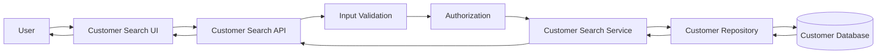
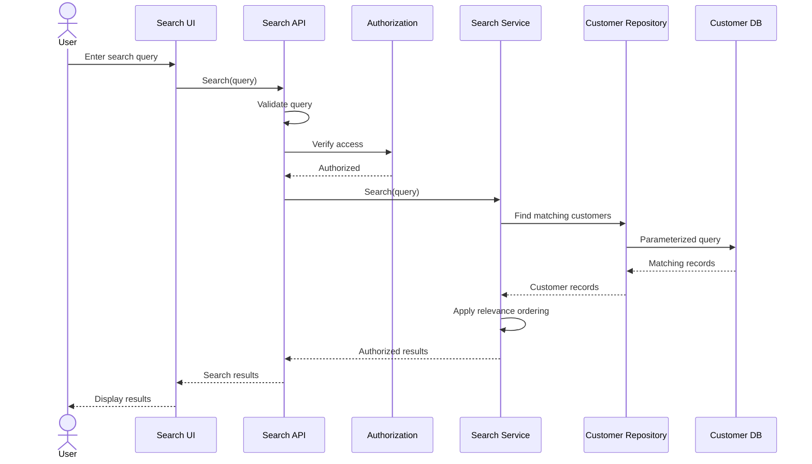

# Architecture

## Overview

The Customer Search feature follows a layered architecture that separates the user interface, application logic, data access, and security concerns.

The feature receives a search query from the client, validates the input, verifies the user's authorization, searches the customer data source, orders the matching records by relevance, and returns the authorized results to the client.



## Components

### Customer Search UI

Provides the search interface for desktop and mobile users.

Responsibilities include:

- Accepting the search query.
- Sending the query to the backend.
- Displaying matching customers.
- Displaying the no-results message.
- Displaying appropriate error messages.

### Customer Search API

Provides the HTTP endpoint used by the client to perform customer searches.

Responsibilities include:

- Receiving the search request.
- Passing the query to the application layer.
- Returning search results.
- Returning appropriate HTTP responses for validation, authorization, and unexpected errors.

### Input Validation

Validates the search query before it reaches the data-access layer.

Responsibilities include:

- Handling leading and trailing whitespace.
- Handling empty queries according to the defined validation behavior.
- Safely handling special characters.
- Preventing unsafe input from being interpreted as executable code or an unsafe database query.

### Authorization

Ensures that the authenticated user can access the customer information returned by the search.

Responsibilities include:

- Checking the user's permissions.
- Preventing unauthorized customer records from being returned.
- Ensuring that restricted customer information is not exposed.

### Customer Search Service

Contains the application logic for customer searching.

Responsibilities include:

- Applying the search rules defined in `SPEC.md`.
- Searching by name and email.
- Supporting partial matches.
- Applying the relevance ordering.
- Returning only authorized customer data.

### Customer Repository

Provides access to customer data without exposing database implementation details to the application layer.

Responsibilities include:

- Executing the customer search.
- Applying database-safe query parameters.
- Returning matching customer records.
- Supporting efficient searches against the customer dataset.

### Customer Database

Stores customer records and provides the data required by the search feature.

At minimum, the relevant fields are:

- `customerId`
- `name`
- `email`

## Responsibilities

| Component | Responsibility |
|---|---|
| Customer Search UI | Collect query and display results |
| Customer Search API | Handle HTTP requests and responses |
| Input Validation | Validate and sanitize search input |
| Authorization | Enforce access permissions |
| Customer Search Service | Apply search and relevance rules |
| Customer Repository | Retrieve customer records |
| Customer Database | Store and query customer data |

## Data Flow

1. The user enters a name or email search query.
2. The UI sends the query to the Customer Search API.
3. The API validates the request.
4. The authorization layer verifies that the user can access customer information.
5. The Customer Search Service applies the search rules.
6. The Customer Repository executes a parameterized search against the database.
7. Matching customer records are returned to the service.
8. The service applies the required relevance ordering and ensures that only authorized information is returned.
9. The API returns the results to the UI.
10. The UI displays the matching customers or the appropriate no-results message.



## Interfaces

### Search API

The feature exposes an HTTP endpoint for customer searches.

Example:

```http
GET /api/customers/search?q={query}
```

### Request

The request contains:

| Parameter | Type | Required | Description |
|---|---|---|---|
| `q` | string | Yes | Name or email search query |

Example:

```http
GET /api/customers/search?q=john
```

### Successful Response

```json
{
  "results": [
    {
      "customerId": "123",
      "name": "John Smith",
      "email": "john.smith@example.com"
    }
  ]
}
```

Only fields that the authenticated user is authorized to see shall be included.

### No Results Response

The API shall return an empty result collection when no authorized customers match the query.

```json
{
  "results": []
}
```

The UI is responsible for displaying the appropriate no-results message.

### Error Responses

The API shall use appropriate HTTP responses for:

- Invalid search input.
- Unauthorized access.
- Unexpected server errors.

The response body shall not expose sensitive customer information or internal implementation details.

## Error Handling

### Validation Errors

Invalid input shall be rejected or safely handled before reaching the database.

### Authorization Errors

Unauthorized users shall not receive restricted customer records.

The system shall avoid exposing information that could reveal the existence of unauthorized customer records.

### Database Errors

Database failures shall be handled by the application layer and converted into an appropriate API error response.

Database implementation details shall not be exposed to the client.

### Unexpected Errors

Unexpected failures shall return a generic error response.

Internal stack traces, database queries, credentials, and other sensitive implementation details shall not be exposed.

## Testing Strategy

Testing shall cover the behavior defined in `SPEC.md`.

### Unit Tests

Unit tests shall verify:

- Full name matching.
- Partial name matching.
- Full email matching.
- Partial email matching.
- Relevance ordering.
- Empty search behavior.
- Whitespace handling.
- Special-character handling.
- Authorization filtering.
- Error handling.

### Integration Tests

Integration tests shall verify:

- API request and response behavior.
- API-to-service communication.
- Service-to-repository communication.
- Repository-to-database searches.
- Authorization enforcement.
- Database-safe parameterized searches.

### Performance Tests

Performance testing shall verify that customer searches meet the requirement of returning results within 2 seconds for at least 95% of searches under normal operating conditions.

Testing should include a representative large customer dataset.

### UI Tests

UI tests shall verify:

- Search input behavior.
- Results rendering.
- No-results message.
- Error messages.
- Desktop usability.
- Mobile usability.

## Dependencies

The feature depends on:

- Existing customer database.
- Existing authentication mechanism.
- Existing authorization mechanism.
- Backend API framework.
- Database access layer or ORM.
- Customer repository implementation.
- Frontend UI framework.
- Existing application error-handling mechanisms.

No new authentication or authorization system is required for this feature.

## Design Decisions

### DD-01 — Layered Search Architecture

The feature separates UI, API, application logic, authorization, and data access.

This prevents the UI from directly accessing the database and keeps search behavior centralized in the application layer.

### DD-02 — Parameterized Database Queries

Customer searches shall use parameterized queries or the equivalent safe mechanism provided by the database access technology.

This prevents user-provided search input from being interpreted as part of a database query.

### DD-03 — Authorization Before Returning Results

Authorization is enforced before customer information is returned to the client.

This ensures that search functionality does not become a mechanism for discovering unauthorized customer records.

### DD-04 — Relevance Ordering in the Application

The search service is responsible for applying the defined relevance behavior.

The exact relevance criteria remain an open question and shall be finalized before implementation.

### DD-05 — Responsive Client

The search interface shall be implemented using responsive UI behavior so that the same feature can be used on desktop and mobile devices.

## Trade-offs

### Simplicity vs. Advanced Search

Searching only by name and email keeps the feature focused and reduces implementation complexity. More advanced filters can be added separately if they become requirements.

### Database Search vs. Dedicated Search Engine

Using the existing customer database avoids introducing another infrastructure component. A dedicated search engine could provide more advanced search capabilities, but would introduce additional operational and maintenance complexity.

### Relevance Accuracy vs. Implementation Complexity

A simple relevance strategy is easier to implement and maintain. More sophisticated ranking could provide more precise results but would require additional rules and potentially more processing.

### Security vs. Search Convenience

Authorization and restricted-field handling may limit the information returned to users, but these controls are necessary to prevent unauthorized customer information from being exposed.

### Performance vs. Query Complexity

Optimizing the database query and relevant fields can improve response time while keeping the architecture relatively simple. More advanced optimization techniques should only be introduced if performance testing demonstrates a need for them.